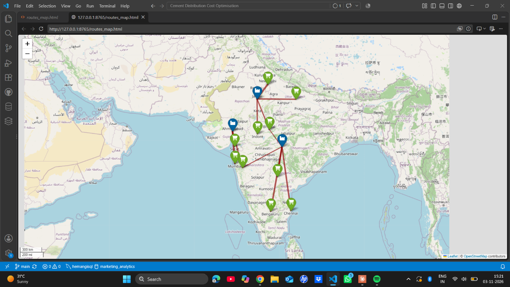

# Cement Distribution Cost Optimisation

A small, reproducible example of the **capacitated transportation problem**: decide how many tonnes to ship from each cement plant to each dealer while meeting all demand, respecting plant capacity, and minimizing estimated transport cost.

The project compares a simple nearest-plant-first baseline with a PuLP linear-programming solution, then exports shipment tables and an interactive route map.

## Dataset and assumptions

This repository uses a small, purpose-built illustrative dataset in [`data/plants.csv`](data/plants.csv) and [`data/dealers.csv`](data/dealers.csv). The example uses approximate coordinates of real Indian cities, but the plant identities, capacities, dealer demands, transport distances, and costs are **assumed values**, not company or operational data. No Kaggle dataset is used.

- Three illustrative plants supply ten dealers.
- Plant capacities and dealer demands are in tonnes; total supply must be at least total demand.
- Straight-line distances are calculated from the city coordinates and multiplied by **1.25** to approximate road detours. These are estimates, not live road-network distances.
- The assumed transport rate is **₹3 per tonne-kilometre**, the same for every route. The model minimizes distance-weighted transport cost; it does not include fixed truck costs, loading constraints, tolls, time windows, or vehicle routing.
- The baseline serves dealers in CSV order, using the nearest plant with capacity left and splitting a dealer's demand if needed.
- The optimizer solves a continuous linear program. Shipments may be fractional tonnes.

Replace the example CSV rows and assumptions with verified data before using this for business decisions.

## Requirements

- Python 3.10 or later
- Packages in [`requirements.txt`](requirements.txt)

## Run

From the project directory:

```powershell
python -m venv .venv
.\.venv\Scripts\Activate.ps1
python -m pip install -r requirements.txt
$env:PYTHONPATH = "src"
python -m cement_optimizer.cli
```

The program prints the baseline and optimized costs and savings. It creates:

- `outputs/route_distances.csv` — estimated distance and unit transport cost for every plant-dealer pair
- `outputs/baseline_allocation.csv` — nearest-plant baseline shipments
- `outputs/optimized_allocation.csv` — minimum-cost shipments
- `outputs/summary.json` — cost and volume comparison
- `outputs/routes_map.html` — interactive map of optimized routes

## Sample output

The sample dataset produces an estimated baseline transport cost of **₹80,824,500** and an optimized cost of **₹67,384,500**, for estimated savings of **₹13,440,000 (16.63%)**. These are illustrative results based on the assumptions above, not verified business savings.

The screenshot below shows the generated optimized routes on the interactive Folium map:



Open `outputs/routes_map.html` in a browser to explore the optimized routes. To skip map generation, run:

```powershell
python -m cement_optimizer.cli --no-map
```

Use `--data-dir` and `--output-dir` to provide alternate input and output folders.

## Tests

```powershell
$env:PYTHONPATH = "src"
python -m unittest discover -s tests -v
```
